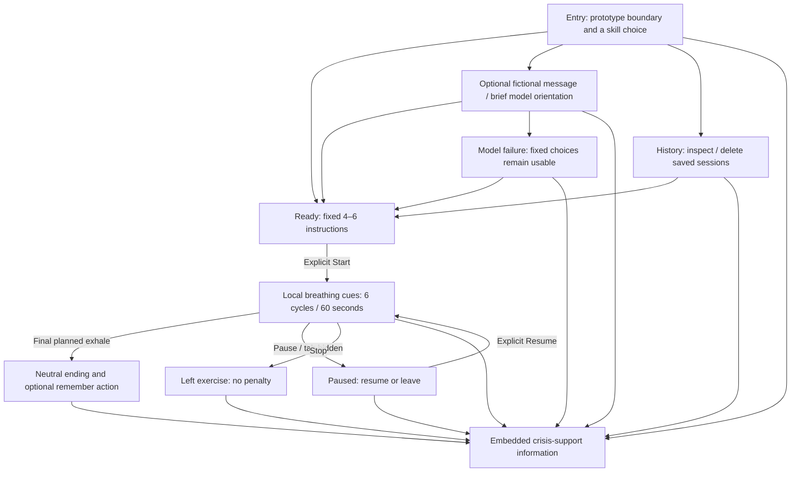

# A little space · Research and design

**Milestone:** 3.1, October 15, 2026. **Status:** proposed design; not a working support application. **Audience:** instructor and classmates role-playing fictional scenarios on localhost. The study concerns BPD participants, but this prototype neither identifies nor diagnoses a target user.

## Proposal and coherent scope

A little space offers a short, explicitly chosen skill with minimal required reading or disclosure. The first implemented skill will be **paced breathing: inhale for four, exhale for six, repeat six times**. A quiet phase label and optional expanding/contracting cue carry the pace. A person can stop, pause or open support information from every exercise screen.

An optional **STOP** extension gives a non-breathing choice: stop; take a step back; observe internally and externally; proceed mindfully. It is visibly marked as a later extension until implemented. Its four steps remain fixed. Sensory grounding and cognitive reframing are outside the first working milestone: grounding adds more step handling, while reframing would require more disclosure and reasoning. We are prioritizing a complete, testable first skill over a four-skill catalog.

The model contributes a short, context-aware orientation before a skill, using an optional fictional message and an explicitly remembered preference. It may explain the available choice using fixed content, but cannot prescribe a new intervention, diagnose, control timing or silently route the user. The exercise can start without typing or waiting for the model.

## Main experience

See [the annotated storyboard](storyboard.svg) and [the clickable screen walkthrough](prototype.html). Both were created during the design milestone, before application implementation.

**Global invariant:** Crisis support is a persistent header control on entry, ready, chat/loading/error, exercise, pause, ending, history and storage-failure states. Stop/Leave remains a direct control. In the diagram only representative edges to support are drawn; the implementation must attach it to the shared layout, not each route conditionally.

### Screen contract and representative copy

| State | Main content / action | Secondary controls and result |
| --- | --- | --- |
| Entry | “Choose a short practice.” / “Paced breathing · about 1 minute.” | “Less on screen”, History, Crisis support, Leave. Prototype boundary is explicit. |
| Remembered entry | “Your usual: paced breathing. You chose this last time.” / Use my usual | Choose another remains available. Never auto-start. A missing preference produces ordinary entry. |
| Ready | “Breathe in for four, out for six. Six rounds. Follow only if comfortable.” / Start | No model wait. Stop returns directly. “Without motion” is available here and respects OS preference. |
| Optional chat | “Fictional situation (optional)” / Send | Fixed choices and Skip stay visible during loading; no pre-exercise questionnaire. |
| Model failure | “The message couldn’t load. The practice is still available.” / Continue without a reply | Explicit Retry, Leave, Crisis support. Late responses cannot replace a running exercise. |
| Exercise | Current phase only: “Breathe in · 4” or “Breathe out · 6.” | Pause, Stop, Crisis support. A small round indicator is informational, not a score. No new decisions or model messages appear. |
| Paused | “Paused. There’s no need to finish.” / Resume | Leave, Crisis support. Timer progress freezes. Resume starts the interrupted round's inhale, with that partial round counted as pause-related replay, not silently completed time. |
| Ending | “The minute is over. You can leave it here.” / Done | Optional “Use this as my usual.” No mood rating, praise, streak or required feedback. No automatic second round. |
| Stopped | “You stopped. You don’t need to explain.” / Back to choices | No “failed” status in the user-facing UI. History may say “Left early.” |
| Support | Static U.S. support contact information and plain scope statement | Pause active practice on open; contact actions require deliberate activation. Close returns to a paused state. No model, classifier, network fetch or save is required to display the information. |
| History | Date, chosen skill, completed/left/paused, optional conversation transcript | Details collapsed by default; no emotional score or benefit claim. Deleting session removes dependent messages; persistent support/leave remains. |

Every screen states or inherits the coursework context. Fictional examples must not resemble saved real health records. Copy avoids “you're safe,” “you'll feel better,” diagnostic labels and simulated monitoring.

## Research-to-design decisions and tradeoffs

| Finding | Concrete decision | What is gained / given up | Proposed check |
| --- | --- | --- | --- |
| R1 | Six fixed 4+6-second rounds, no model in sequence | Predictable short flow; less variety. Actual performance still needs measurement. | Measure first instruction through final exhale; target ~60 seconds, <=90 active seconds. |
| R2 | One activation opens already-bundled support information | No dependence on requests; must maintain region/currency of details. | Open from every route while backend/model is unavailable. |
| R3 | Direct stop and leave, no confirmation or required explanation | Low exit cost; completion statistics are incomplete and must not be interpreted as success rates. | Stop in inhale, exhale, pause and model loading; no penalty or delayed restart. |
| R4 | Start always requires explicit choice; change/leave remain available | More agency; sometimes an extra tap compared with auto-routing. | Remembered preference cannot start a timer or remove choices. |
| D1 | Explicit “Less on screen”; during practice both modes are already minimal | Predictable correction without diagnosing; no automatic response to unexpressed distress. | Change mode at any stage; safety and stop stay visible. |
| D2 | One active phase or STOP step at a time | Less simultaneous reading; sequence overview is placed before, not during, the skill. | Exercise screenshot shows one instruction; no dashboard or conversational interruption. |
| D3 | Skip chat/feedback; no sensory answers or diary required | Low disclosure burden; less personalized evidence for the model. | Reach Start and Done without typing; no forced ratings. |
| D4 | Support in shared layout and static local copy | Persists through failures; a resource panel still needs outside connectivity to call/chat. | Disable model and network; information stays readable, with honest offline limits. |
| D5 | Optional one-tap remember after choosing/completing; entry states the source | No settings wizard or hidden inference; offers only a simple preference, not adaptive clinical guidance. | Remember, restart, choose differently, clear preference; history deletion does not resurrect it. |
| D6 | Quiet palette, plain text, no auto audio, motion alternative | Less stimulation; pacing must stay intelligible without movement or sound. | Reduced-motion, keyboard, screen-reader phase announcements and contrast checks. |

Simplification removes examples, past-session previews and optional chat from the main choice screen. It does **not** hide alternatives, privacy access, crisis support, stop, or the ability to return to fuller choices. A single “More options” opens the omitted nonessential material; no change is inferred from diagnosis, typing speed, silence, message sentiment or elapsed time.

## Personalization and control

Default behavior makes no emotional inference. The user can explicitly remember the chosen skill from the ending screen or a history item; leaving early never silently changes it. The preference contains the skill identifier and the session the user chose it from, not a score or a model-inferred trait. Entry offers “Use my usual” and “Choose another” with equal access to alternatives. Remembering a choice never selects a screen density or starts a skill.

The optional conversation receives the current fictional message, the last four messages from the **current session only**, the allowed skill content, and the explicit usual-skill preference if present. Old transcripts are for user review and are not automatically supplied to the provider. This sacrifices richer model personalization to reduce disclosure and prevent old text from dominating a new choice. Deleting or clearing history cannot make the model rebuild a preference from removed messages.

“Less on screen” is independent and reversible. Remember it only when the user asks; default to the current-session setting otherwise. Motion defaults to the operating-system preference; a session override never changes the system setting. No streaks, goals, distress scores, personality profile or benefit ranking are saved.

## Duration budget and assumptions

**Breathing:** first exercise instruction is displayed immediately when Start is activated. Six rounds × (4 seconds inhale + 6 seconds exhale) = **60 seconds planned active instruction**. No initial countdown, model request, completion survey, transition animation or extra hold is inserted. The final planned step ends with the sixth exhale. Local rendering/scheduling delays count toward the measurement; the <=90-second target includes them. A runtime failure to meet it is a failed timing check, not time to subtract from the evidence.

Entry/setup is reported separately: assumed ~10–25 seconds to read and choose; an optional model request may add up to the proposed 8-second request timeout and user reading time. These are planning estimates, not observations. No timed user response is required during breathing.

User pauses, background-tab time and support-panel time are separately logged and excluded from intended active pacing. Resume repeats only the interrupted round from its inhale; any extra partial-round time is reported as pause-related replay. This is explicit in the evidence, never concealed in a 60-second claim. Leaving does not force the final step, and ending the planned minute does not redirect or close the user's screen.

**Optional STOP:** four separate screens, with fixed sequence and Next chosen by the user. Budget 10/10/20/10 seconds for reading/reflection, ~2 seconds per local transition = **56 seconds intended pace**, no model delay. Slower voluntary responses are allowed and actual unpaused duration is reported. A faster skip may advance a step but cannot be called evidence that all reflection occurred. STOP timing remains a separate future check; it is not required to finish Part 3.2 breathing.

## Safety, privacy and accessibility boundaries

The crisis route is independent of all detection. A small deterministic text-rule layer may conservatively show the same support panel after an explicit crisis-related phrase; it never blocks the persistent control, labels the user safe, or starts a skill. It may miss euphemisms, language variations or negation and may flag fictional discussion. No classifier accuracy is claimed. [Precise behavior and resource copy](technical-design.md).

Conversation and session persistence are useful for history but increase privacy cost. Only fictional content is permitted in this coursework prototype; disclose local storage before the first send. There are no analytics, cloud history, names or accounts. Local SQLite is not encrypted, and model-bound text still leaves the computer. No free text is sent until Send is activated. Local-history storage is distinct from provider retention; local deletion cannot erase a request already sent to a provider.

Controls must be keyboard reachable, have visible focus and adequate contrast, and use at least 44-pixel targets as a design target. In active practice, announce phase changes politely rather than every countdown tick. Without motion, phase labels and numeric counts preserve pace. No audio, microphone, speech recognition, vibration or compulsory animation is in scope. At phone widths and browser zoom the shared safety/exit row must remain usable without covering the instruction. No accessibility conformance is claimed from a sketch.

## Unresolved questions and decision gates

1. Can the quiet phase label/countdown remain understandable without motion or per-second screen-reader announcements? Test with fictional role-play before choosing the final cue.
2. Is an optional eight-second model timeout still too demanding before a choice? Compare Skip with mock slow/failure responses; never move the request into the timed exercise.
3. Does the usual-skill offer save effort without looking like a recommendation of clinical benefit? Inspect wording and demonstrate override/clear behavior.
4. Which explicit crisis phrases should the conservative rule layer recognize? Review false positives and misses with fictional cases; keep resource access unconditional.
5. Which currently available backend model can follow the bounded orientation contract consistently? Credentials are currently missing. Select/check a free Nemotron configuration before Part 3.2 live cases; do not claim hotel chatbot live integration has been verified.
6. Is STOP necessary for the first working version? Add only after the breathing flow, exit/failure paths, persistence and timing pass. No non-breathing therapeutic alternative will be invented by the model to fill this gap.

These are implementation/evaluation questions, not reasons to leave the Part 3.1 design unexplained. [Technical contracts](technical-design.md) and [planned tests](verification.md) make the next steps concrete.
